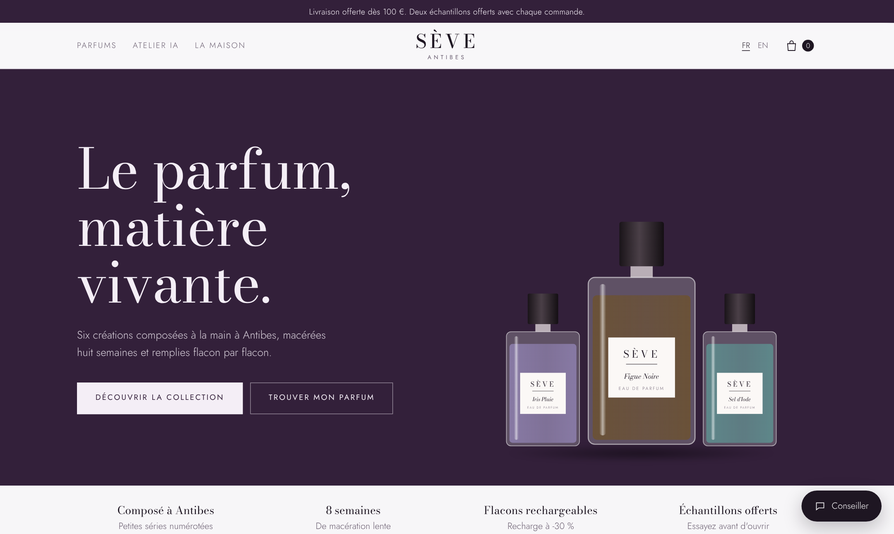
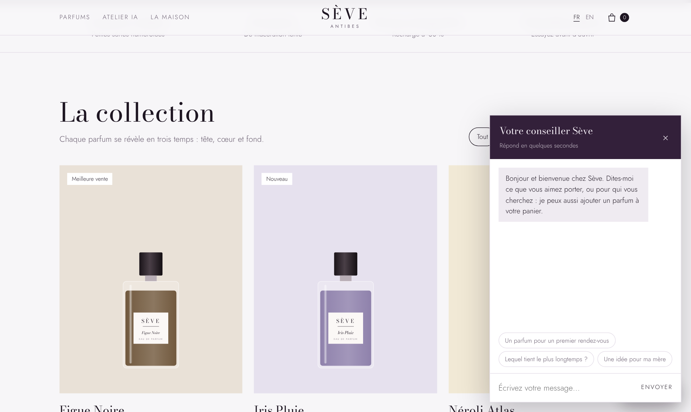
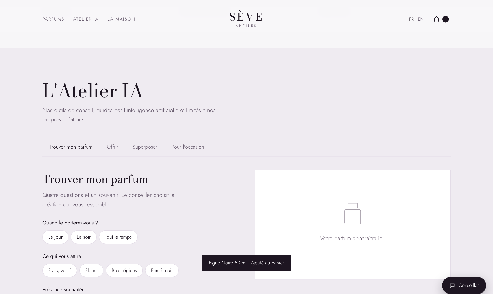
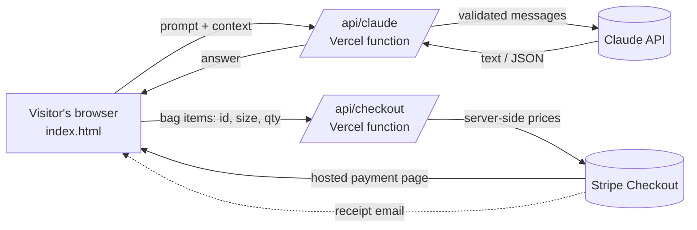
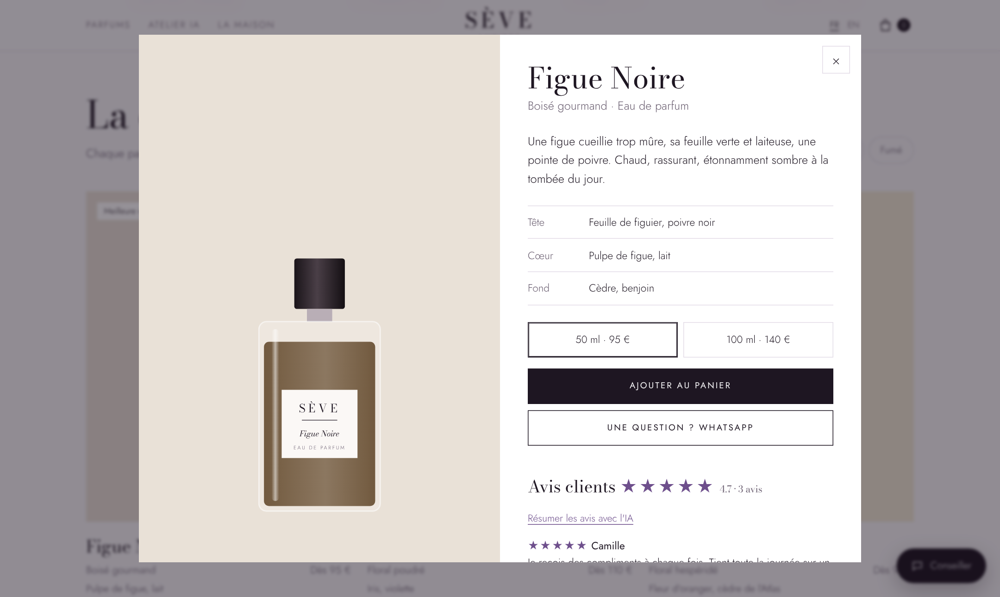
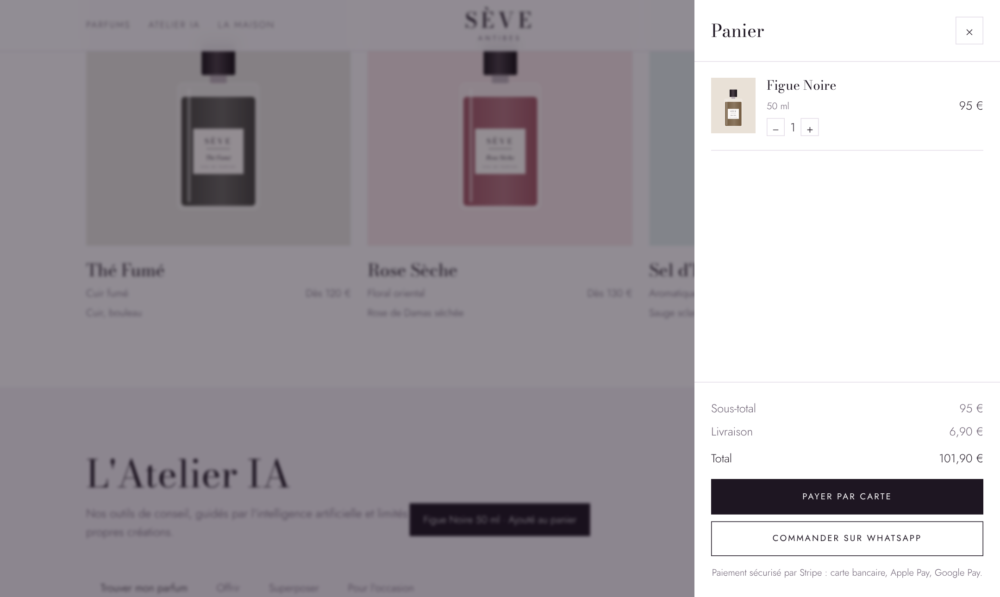

# Sève · AI-powered e-commerce for an artisan perfume house

**An LLM-driven shopping experience: 7 AI features grounded in a product catalog, secure card payment, and a serverless backend.**

[](https://seve-parfums.vercel.app)




> Sève is a fictional brand created as a demo. Products, prices and reviews are placeholders. Payments run in Stripe **test mode**: use card `4242 4242 4242 4242`, any future date, any CVC.

---

## The problem

Buying perfume online is hard: customers can't smell the product. Small artisan houses lose sales because shoppers don't know which scent suits them, and the owners rarely have time to write product copy in several languages.

This project uses a large language model to play the role of an **in-store perfume advisor**, while keeping it strictly grounded in the brand's real catalog so it never recommends a product that doesn't exist.

## AI features

| Feature | What it does | LLM technique |
|---|---|---|
| **Concierge chat** | Conversational advisor that recommends perfumes and can add them to the bag | Multi-turn context window, catalog grounding, action tags parsed into UI actions |
| **Scent-finder quiz** | 4 questions + a free-text "scent memory" → best match + runner-up | Closed-set recommendation, structured JSON output |
| **Gift advisor** | Describe the recipient → perfume within budget + a personal card message | Constraint-aware selection (budget), controlled text generation |
| **Layering lab** | Pick two perfumes → blend name, honest verdict, how to wear them | Reasoning over note structures (top / heart / base) |
| **Scent for the occasion** | Describe a moment (place, outfit, weather) → the right perfume | Context-to-product matching |
| **Review summarizer** | Summarizes customer reviews into what people love + one caveat | Abstractive summarization, streamed output |
| **Brand space** (internal tool) | Writes product pages, Instagram posts or newsletters in FR and EN | Format-specific generation, bilingual output |

Every AI answer is generated in the visitor's language (French or English).

<p>
  
  
</p>

## Architecture



- **Frontend:** a single static page (vanilla JavaScript, no framework), with the catalog, the UI and the prompt templates.
- **`/api/claude`:** a serverless proxy that keeps the API key secret, validates and limits requests, then calls the Claude Messages API.
- **`/api/checkout`:** a serverless function that rebuilds the order from a server-side price list and creates a Stripe Checkout session.

## How the AI layer is designed

**1. Grounding in the catalog.** Each prompt includes the full catalog (id, family, top / heart / base notes, prices) and the model may only answer with a catalog `id`. The page then looks the id up locally; an unknown id falls back to a safe default, so the UI never shows an invented product.

**2. Structured outputs.** Recommendation features ask for a strict JSON schema, for example:

```json
{ "pick": "iris-pluie", "reason": "...", "runnerUp": "sel-diode", "runnerReason": "..." }
```

The response is cleaned (code fences removed), the first JSON object is extracted and parsed, and the UI is rendered from the parsed fields, never from raw model text.

**3. Lightweight tool use.** The concierge can act on the page: when a customer asks to buy something, the model ends its reply with an action tag `[[ADD <id> <50|100>]]`. The page parses it with a regex, validates the id against the catalog, updates the bag and strips the tag before display.

**4. Guardrails in the prompts.** The model is told not to invent products, discounts, shipping policies or longevity claims, to redirect off-topic questions back to perfume, and to send logistics questions to the team.

**5. Cost and latency control.** A fast, low-cost model handles the interactive features, conversation history is capped at the last 16 turns, and output length is capped at 800 tokens.

**6. Security.**
- The API keys live only in server environment variables, never in the page.
- `/api/claude` accepts only `user` / `assistant` text messages, caps request size (12,000 characters) and rate-limits each IP (12 requests per minute).
- `/api/checkout` ignores any price sent by the browser and recomputes the order from its own price list, so a customer can't change what they pay.

More detail, including prompt templates: [docs/ai-design.md](docs/ai-design.md)

## E-commerce features

- Collection with family filters, badges and product pages (notes pyramid, 50 / 100 ml sizes)
- Persistent bag, subtotal, free delivery threshold
- **Card payment with Stripe Checkout** (cards, Apple Pay, Google Pay), receipt email, success and cancel handling
- **Order on WhatsApp** with a pre-filled order summary
- Bilingual FR / EN interface, light and dark mode, responsive down to phone width
- Legal page template for French e-commerce (mentions légales, CGV, 14-day withdrawal, GDPR)

<p>
  
  
</p>

## Tech stack

| Layer | Tools |
|---|---|
| Frontend | HTML, CSS, vanilla JavaScript, inline SVG |
| AI | Claude Messages API, prompt engineering, JSON outputs |
| Backend | Vercel serverless functions (Node.js) |
| Payments | Stripe Checkout API |
| Hosting / CI | GitHub → Vercel (automatic deploy on every push) |

## Project structure

```
├── index.html          # website: UI, catalog, i18n texts, prompt templates
├── legal.html          # legal pages template (FR)
├── api/
│   ├── claude.js       # LLM proxy: validation, rate limiting, Claude API call
│   └── checkout.js     # Stripe Checkout session with server-side prices
├── docs/
│   ├── ai-design.md    # prompt design and AI decisions
│   └── screenshots/
└── .env.example        # environment variables to set
```

## Run it yourself

**Requirements:** a [Claude API key](https://console.anthropic.com) and a [Stripe](https://dashboard.stripe.com) test secret key.

```bash
git clone https://github.com/AtikaWamra/seve-parfums.git
cd seve-parfums
npm i -g vercel
cp .env.example .env.local   # then add your keys
vercel dev                   # http://localhost:3000
```

**Deploy:** import the repository on [vercel.com](https://vercel.com), add `ANTHROPIC_API_KEY` and `STRIPE_SECRET_KEY` in *Settings → Environment Variables*, then redeploy.

## Roadmap

- **Evaluation suite:** a set of test profiles with expected recommendations to measure the quiz's accuracy and consistency across prompt or model changes
- **Preference analytics:** store anonymized quiz answers and recommendations to analyse which scent families each customer segment prefers
- **RAG over product sheets:** retrieve detailed perfumer notes instead of sending the full catalog in every prompt, so the catalog can scale
- **Stripe webhooks:** save confirmed orders to a database and notify the owner
- **Authentication** for the internal brand space

## Author

**Atika Wamra** · Data & AI consultant
[LinkedIn](https://www.linkedin.com/in/wamra-atika) · [GitHub](https://github.com/AtikaWamra)

## License

[MIT](LICENSE)
